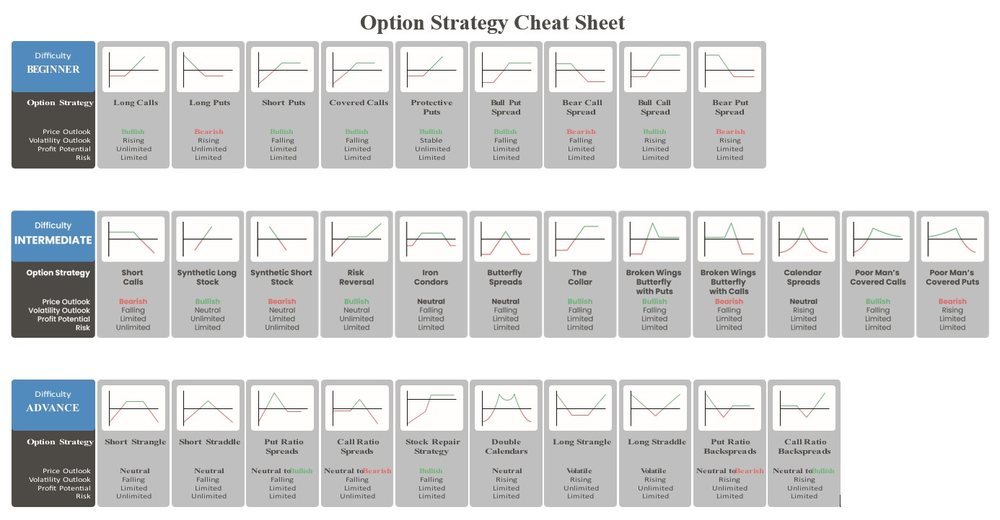
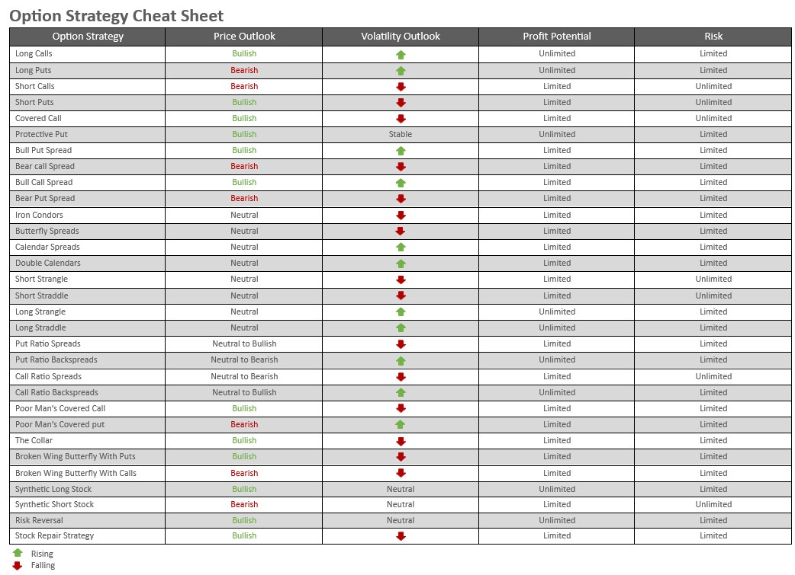
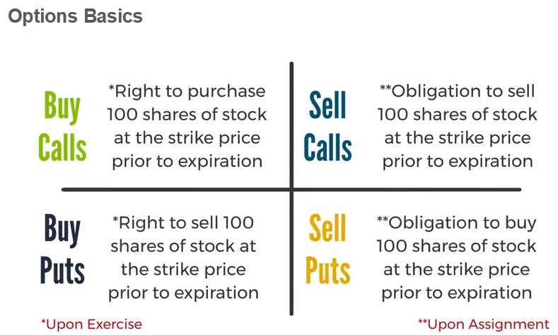
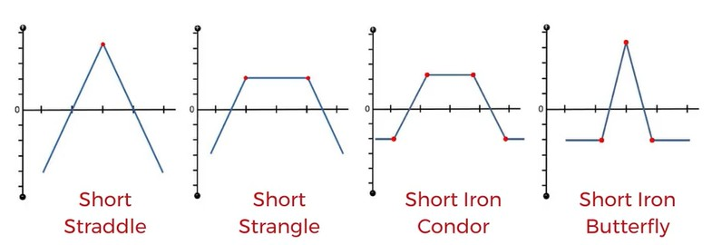
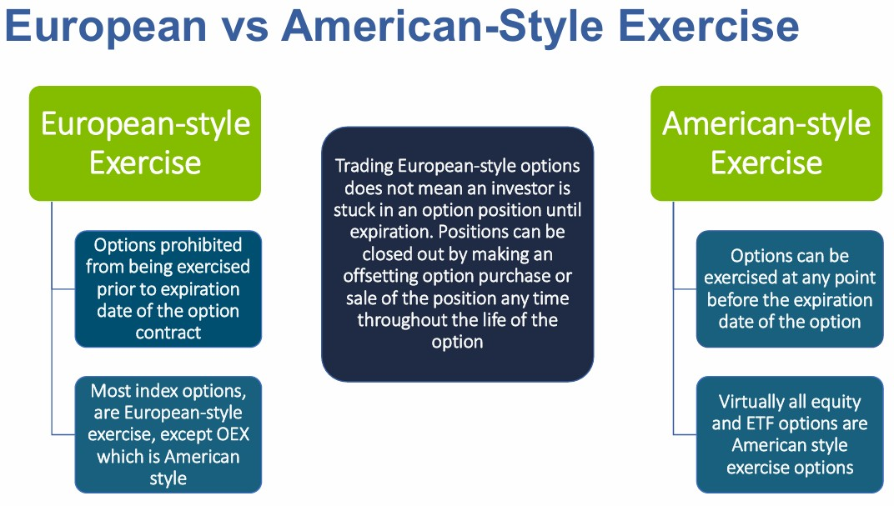

# Automated Algorithmic Trading System

## Table of Contents <!-- omit from toc -->

- [Trading](#trading)
  - [Market Hours](#market-hours)
  - [Market Calendar](#market-calendar)
  - [Stocks to monitor](#stocks-to-monitor)
  - [My Filters](#my-filters)
  - [My Strategies](#my-strategies)
- [Trading Strategies and Patterns](#trading-strategies-and-patterns)
  - [Technical Analysis](#technical-analysis)
  - [Trading Indicators](#trading-indicators)
  - [Trading Candlesticks](#trading-candlesticks)
  - [Trading Patterns](#trading-patterns)
  - [Option Strategies](#option-strategies)
- [Database](#database)
  - [polygon](#polygon)
  - [securities](#securities)
- [Projects](#projects)
  - [Securities Load](#securities-load)
  - [Trading Utilities](#trading-utilities)
  - [Securities Notebooks](#securities-notebooks)
  - [Polars Backtesting Engine](#polars-backtesting-engine)
- [Front-Ends](#front-ends)
  - [Budibase](#budibase)
  - [DBeaver](#dbeaver)
  - [Streamlit Dashboard](#streamlit-dashboard)
- [Education](#education)
  - [Options](#options)
  - [Indices](#indices)
  - [ETF's](#etfs)
  - [Indces vs ETFs](#indces-vs-etfs)
  - [VIX](#vix)
  - [Stocks](#stocks)
  - [Futures](#futures)
- [Backtesting](#backtesting)
  - [Performance Measuring Methods](#performance-measuring-methods)
  - [Backtesting Libraries](#backtesting-libraries)
- [Python libraries](#python-libraries)
  - [Indicators and Patterns](#indicators-and-patterns)
  - [Option libraries](#option-libraries)
- [Option platforms](#option-platforms)
- [Helpful Links](#helpful-links)
- [TODO](#todo)

## Trading

- [Financial Wisdom (YouTube)](https://www.youtube.com/c/FinancialWisdom)
- [ASX Online courses](https://www.asx.com.au/investors/investment-tools-and-resources/online-courses)

### Market Hours

#### United States

- Regular Trading Hours - 9:30 a.m. to 4:00 p.m. Eastern Time Monday to Friday.
- Pre-Market Trading Hours: 4:00 a.m. to 9:30 a.m.
- After-Hours Trading: 4:00 p.m. to 8 p.m.

#### Australia

- 10:00 a.m. to 4:00 p.m. Australian Eastern Standard Time

[🠉](#table-of-contents)

### Market Calendar

#### United States - 2026

| Public Holiday | Date | Trading Day |
| :---- | :-- | :------- |
| New Year’s Day | Thursday 1 January | CLOSED |
| Martin Luther King, Jr. Day | Monday 19 January | CLOSED |
| Washington's Birthday | Monday 16 February | CLOSED |
| Good Friday | Friday 3 April | CLOSED |
| Memorial Day | Monday 25 May | CLOSED |
| Juneteenth National Independence Day | Friday 19 June | CLOSED |
| Independence Day (observed) | Friday 3 July | CLOSED |
| Labor Day | Monday 7 September | CLOSED |
| Thanksgiving | Thursday 26 November | CLOSED |
| Friday after Thanksgiving | Friday 27 November | CLOSE EARLY 13:00 |
| Last Business day before Christmas Day | Thursday 24 December | CLOSE EARLY 13:00 |
| Christmas Day | Friday 25 December | CLOSED |

#### Australia - 2026

| Public Holiday | Date | Trading Day |
| :---- | :-- | :------- |
| New Year’s Day | Thursday 1 January | CLOSED |
| Australia Day | Monday 26 January | CLOSED |
| Good Friday | Friday 3 April | CLOSED |
| Easter Monday | Monday 6 April | CLOSED |
| ANZAC Day | Saturday 25 April | CLOSED |
| King’s Birthday | Monday 8 June | CLOSED |
| Last Business day before Christmas Day | Thursday 24 December | CLOSE EARLY 14:10 |
| Christmas Day | Friday 25 December | CLOSED |
| Boxing Day | Monday 28 December | CLOSED |
| Last Business day of the Year | SThursday 31 December | CLOSE EARLY 14:10 |

[🠉](#table-of-contents)

### Stocks to monitor

| Symbol | Name | Comment |
| :----- | :--- | :----- |
| CAR | Avis Budget Group, Inc. | Gone crazy, when will it crash? |
| RGTI | Rigetti Computing Inc | Quantum stock |
| IONQ | IonQ Inc Class A | Quantum stock |
| QBTS | D-Wave Quantum Inc | Quantum stock |

### My Filters

- No Filter (Baseline Case)
- RSI (Relative Strength Index)
- [ADX (Average Directional Index)](#adx-average-directiona-index)
- Close above average close
- Moving Average Slope
- Williams %R
- Stochastics
- 2 Bar RSI

#### ADX (Average Directiona Index)

```python
If FILTER = 2 Then begin //ADX Filter
    FilterLong = ADX(14) > InputVar2*1.5
    FilterShort = ADX(14) < InputVar2*1.5
If ENTRY = 1 then Begin
    if marketposition=0 and FilterLong and close -close[InputVar1] crosses above 0 then buy next bar at market
```

### My Strategies

- [Bullish Trend Following with Alpaca and Options](#bullish-trend-following-with-alpaca-and-options)
- [Selling a 45-day 12-delta put on the E-mini S&P 500 ( /ES ) and taking profits at 50%](#selling-a-45-day-12-delta-put-on-the-e-mini-sp-500--es--and-taking-profits-at-50)

#### Bullish Trend Following with Alpaca and Options

- Market direction
- Sector Direction
- Best Stock
- Entry Point
- Select option strategy
- Select options
- Calculate stop loss
- Calculate take profit
- Buy options
- Place take profit order
- Monitor trade
  - Close trade to take profit or minimise loss
- Document trade

#### Selling a 45-day 12-delta put on the E-mini S&P 500 ( /ES ) and taking profits at 50%

Stock must be moving up.

##### The Trade

1. Trade symbol /ES in your broker (E-mini S&P 500 futures contract) (Option on a futures contract)
   1. Could also use the Micro E-mini /MES. Try using SPY (SPDR S&P 500 ETF Trust) or QQQ (Invesco QQQ Trust) or SPX (S&P 500 Index)/XSP (S&P 500 MINI SPX OPTIONS INDEX).
2. Select expiration 45 days out
3. Select .12 Delta
4. Sell the put at the .12 Delta
5. Take profit GTC at 50% of Credit Received

##### Risk

1. Take profit at 50%
2. Close trade at 21 days; regardless of profit or loss
3. Keep trade size small

## Trading Strategies and Patterns

- [Designing a Profitable Intraday Strategy Using Python and Alpaca](https://concretumgroup.com/backtesting-7-years-of-free-data-beat-the-market-an-effective-intraday-momentum-strategy-for-the-sp500-etf-spy/)

[🠉](#table-of-contents)

### Technical Analysis

Some interesting links:

- [Technical Analysis, cracked!](https://patternswizard.com/)
- [Best Indicators for Technical Analysis](https://www.quantifiedstrategies.com/indicators-for-technical-analysis/)
- [The Best Technical Indicators: Tested Over 100 Years of Data](https://www.newtrading.io/best-technical-indicators/)
- [7 Technical Indicators to Build a Trading Tool Kit](https://www.investopedia.com/top-7-technical-analysis-tools-4773275)
- [Best Indicators for Technical Analysis](https://www.quantifiedstrategies.com/indicators-for-technical-analysis/)
- [Mastering Technical Indicators For Effective Trading Strategies](https://pandaforecast.com/trading-tools-and-software/mastering-technical-indicators-for-effective-trading-strategies/)
- [12 Proven Ways to Trade Stock Chart Indicators Profitably](https://www.liberatedstocktrader.com/chart-trading-indicators/)

[🠉](#table-of-contents)

### Trading Indicators

Indicators fall into four categories:

- Price indicators (raw price charts, support and resistance lines)
- Trend indicators like moving averages
- Momentum indicators like RSI
- Volume indicators like OBV, VWAP, CMF, MFI and DVH

[🠉](#table-of-contents)

Popular indicators

- [Moving Averages (MA)](#moving-average): Helps spot market trends.
- [Simple Moving Average (SMA)](#simple-moving-average): Smooth out price movements.
- [Exponential Moving Average (EMA)](#exponential-moving-average): Provides clearer signals.
- [Bollinger Bands (BB)](#bollinger-bands): Helps identify volatility.
- [Moving Average Convergence Divergence (MACD)](#moving-average-convergence-divergence): Useful for trend following and momentum trading.
- [Triple Exponential Average (TRIX)](#triple-exponential-average): Momentum oscillator to identify trends and potential buy/sell signals
- [Relative Strength Index (RSI)](#relative-strength-index): Crossing the 30 mark is bullish, while crossing the 70 mark is bearish.
- [Stachastic Oscillator (STOCH)](#stachastic-oscillator): Measures Momentum and overbought/oversold conditions.
- [Aroon Indicator (AROON)](#aroon-indicator): Identifies trend reversals and trend strength.
- [Average True Range (ATR)](#average-true-range): Gauges market volatility.
- [On-Balance Volume (OBV)](#on-balance-volume): Gauges the cumulatiove flow of money in and out of a security.
- [Average Directional Index (ADX)](#average-direction-index): Measures the strength of a trend.
- [Donchian Channels (Donchian Channel)](#donchian-channels): Define absolute highs, lows and midpoint.
- [Parabolic SAR (Stop and Reverse)](#parabolic-sar): Determines price direction and when it is changing.
- [Ichimoku Cloud Indicator](#ichimoku -cloud): Provides insight into trend direction, momentum and support/resistance.
- [Williams Percent Range (Williams %R)](#williams-percent-range): a momemtum indicator.
- [Commodity Channel Index](#commodity-channel-index): Identify overbought and oversold conditions.
- [Volume Weighted Average Price (VWAP)](#volume-weighted-average-price): The average volume of a stock over a rolling period, helping to identify trends
- [Chaikin Money Flow (CMF)](#chaikn-money-flow): Measures the difference between buying and selling pressure, indicating market sentiment
- [Money Flow Index (MFI)](money-flow-index): Assesses the strength of buying and selling pressure, providing insights into market trends. Determines overbought and oversold using volume as well as price.
- [Dynamic Volume Histogram (DVH)](#dynamic-volume-histogram): Visulalises volume intensity based on candle direction, helping to identify strong buying and selling pressure.


[🠉](#table-of-contents)

#### Aroon Indicator

- [How to Use the Aroon Indicator in Trading – Strategies and Tips](https://howtotrade.com/indicators/aroon-indicator/)
- [Aroon Indicator Explained: Best Settings & Strategy Tested](https://www.liberatedstocktrader.com/aroon-indicator/)

[🠉](#table-of-contents)

#### Average Direction Index

- [ADX: The Trend Strength Indicator](https://www.investopedia.com/articles/trading/07/adx-trend-indicator.asp)
- [The Ultimate Guide to the Average Directional Index (ADX) Indicator](https://enlightenedstocktrading.com/average-directional-index/)

[🠉](#table-of-contents)

#### Average True Range

- [Average True Range (ATR) Formula, What It Means, and How to Use It](https://www.investopedia.com/terms/a/atr.asp)
- [Average True Range Indicator (ATR): Trading Strategy and Example](https://howtotrade.com/indicators/average-true-range/)

[🠉](#table-of-contents)

#### Bollinger Bands

Consists of a simple moving average and two standard deviation lines to identify market conditions

- [Bollinger Bands](https://www.bollingerbands.com/bollinger-bands)
- [Bollinmger Bands](https://www.financestrategists.com/wealth-management/fundamental-vs-technical-analysis/bollinger-bands/)

[🠉](#table-of-contents)

#### Chaikin Money Flow

[🠉](#table-of-contents)

#### Commodity Channel Index

- [How to Use the Commodity Channel Index (CCI) Indicator – Trading Strategy](https://howtotrade.com/indicators/commodity-channel-index-cci/)
- [CCI Indicator Guide: Best Settings, Formula, And Usage Tips](https://tradersunion.com/interesting-articles/forex-indicators-for-traders/cci-indicator/)

[🠉](#table-of-contents)

#### Donchian Channels

- [Donchian Channel Explained](https://alchemymarkets.com/education/indicators/donchian-channel/)
- [Best Donchian Channel Trading Strategies Analysis (Settings, Rules, And Indicator)](https://therobusttrader.com/donchian-channel-trading-strategies/)

[🠉](#table-of-contents)

#### Dynamic volume Histogram

[🠉](#table-of-contents)

#### Exponential Moving Average

An Exponential Moving Average (EMA) is a moving average that places greater emphasis on recent data points, making it more sensitive to recent price changes than a Simple Moving Average (SMA).

Common short-term exponential moving averages include the 12-day and 26-day. The 50-day and 200-day exponential moving averages are used to indicate long-term trends.

- [Exponential Moving Average (EMA): Definition, Formula & Usage](https://www.investopedia.com/terms/e/ema.asp)
- [Exponential Moving Average (EMA): How to Use in Trading Strategies](https://quantstrategy.io/blog/what-is-ema-exponential-moving-average/)

[🠉](#table-of-contents)

#### Ichimoku Cloud

- [What Is the Ichimoku Cloud Technical Analysis Indicator?](https://www.investopedia.com/terms/i/ichimoku-cloud.asp)
- [Ichimoku Cloud Trading Strategy: What Is It and How to Use It?](https://howtotrade.com/trading-strategies/ichimoku-cloud/)
- [Ichimoku Cloud Trading Strategy: System, Rules & Backtest](https://www.quantifiedstrategies.com/ichimoku-strategy/)
- [Ichimoku Cloud Indicator:  Definition, How it Works, Formulas, Calculations, and Trading](https://www.strike.money/technical-analysis/ichimoku-cloud)

[🠉](#table-of-contents)

#### Money Flow Index

- [Money Flow Index (MFI): Definition and Uses](https://www.investopedia.com/terms/m/mfi.asp)
- [Money Flow Index (MFI)](https://www.financestrategists.com/wealth-management/fundamental-vs-technical-analysis/money-flow-index-mfi/)

[🠉](#table-of-contents)

#### Moving Average

EMAs place a higher weighting on recent data than on older data, so they are more reactive to the latest price changes than SMAs are, which makes the results from EMAs more timely and explains why the EMA is the preferred average among many traders.

- [Moving Averages](https://www.financestrategists.com/wealth-management/fundamental-vs-technical-analysis/moving-averages/)
- [What is a moving average, and how can I use it in my trading?](https://pepperstone.com/en-au/learn-to-trade/trading-guides/what-is-a-moving-average/)

[🠉](#table-of-contents)

##### Golden Cross

Occurs when a short-term moving average crosses above a long-term moving average, signalling a potential bullish trend. This should be reinforced by high volumes.

[🠉](#table-of-contents)

##### Death Cross

Occurs when a short-term moving average crosses below a long-term moving average, signalling a potential bearish trend.

[🠉](#table-of-contents)

##### Moving Average Crossover

Uses two moving averages with different timeframes to generate buy and sell signals

[🠉](#table-of-contents)

#### Moving Average Convergence Divergence

Calculates the difference between two moving averages and compares it to a signal line.

- [What is MACD](https://www.investopedia.com/terms/m/macd.asp)
- [When To Use And How To Read The MACD Indicator](https://commodity.com/technical-analysis/macd/)

[🠉](#table-of-contents)

#### On-Balance Volume

- [On-Balance Volume (OBV): How It Works and How to Use It](https://www.investopedia.com/terms/o/onbalancevolume.asp)
- [On-Balance-Volume (OBV): Definition, How it Works, Calculations, and Trading](https://www.strike.money/technical-analysis/on-balance-volume)

[🠉](#table-of-contents)

#### Parabolic SAR

- [Introduction to the Parabolic SAR](https://www.investopedia.com/trading/introduction-to-parabolic-sar/)
- [Parabolic SAR](https://parabolicsar.com/)

[🠉](#table-of-contents)

#### Relative Strength Index

- [Relative Strength Index (RSI) Indicator Explained With Formula](https://www.investopedia.com/terms/r/rsi.asp)
- [Relative Strength Index (RSI): Works, Formula & Calculation](https://www.geeksforgeeks.org/finance/relative-strength-index-rsi-works-formula-calculation/)

[🠉](#table-of-contents)

#### Simple Moving Average

The most commonly used time periods favored by most traders and investors are 10, 20, 50, 100, and 200.

A single moving average can show a stock in the midst of an upward or downward trend. When the stock price exceeds its simple moving average, it is likely in an upward trend. If the stock price is below the simple moving average it is likely in a downtrend.

- [Simple Moving Average (SMA) Explained: Definition and Calculation Formula](https://www.investopedia.com/terms/s/sma.asp)
- [How to Use the Simple Moving Average (SMA) to Trade Australian Stocks](https://thebull.com.au/trading-guides/how-to-use-the-simple-moving-average-sma-to-trade-australian-stocks/)

[🠉](#table-of-contents)

#### Stachastic Oscillator

- [Stochastic Oscillator: What It Is, How It Works, How To Calculate](https://www.investopedia.com/terms/s/stochasticoscillator.asp)
- [Stochastic Oscillator (Fast, Slow, and Full)](https://chartschool.stockcharts.com/table-of-contents/technical-indicators-and-overlays/technical-indicators/stochastic-oscillator-fast-slow-and-full)
- [Stochastic Oscillator: Explained & Examined](https://analyzingalpha.com/stochastic-oscillator)

[🠉](#table-of-contents)

#### Triple Exponential Average

Employs three moving averages with different timeframes to reduce false signals and capture trends.

- [TRIX Indicator](https://www.wallstreetmojo.com/trix-indicator/)
- [How to Use the TRIX Indicator – Trading Strategy and Best Settings](https://howtotrade.com/indicators/trix-indicator/)
- [What is Triple Exponential Average? How to Trade with TRIX Indicator?](https://quantstrategy.io/blog/what-is-triple-exponential-average-how-to-trade-with-trix-indicator/)

[🠉](#table-of-contents)

#### Volume Weighted Average Price

[🠉](#table-of-contents)

#### Williams Percent Range

- [How to Use Williams %R (Williams Percent Range)](https://www.babypips.com/learn/forex/williams-r)
- [How to use Williams Percent Range (%R) Indicator in Trading Strategies](https://quantstrategy.io/blog/how-to-use-williams-percent-range-r-indicator-in-trading-strategies/)
- [Williams %R (Williams Percentage Range)](https://alchemymarkets.com/education/indicators/williams-r/)

[🠉](#table-of-contents)

### Trading Candlesticks

- [Candlestick Patterns Explained](https://www.tradingsim.com/blog/candlestick-patterns-explained)
- [Candlestick Patterns Cheat Sheet](https://www.chartguys.com/candlestick-pattern-cheat-sheet)
- [TC2000 Candlestick patterns](https://help.tc2000.com/m/69445/c/226486)
- [Japanese Candlesticks](https://pypi.org/project/japanese-candlestick/) - Class based
- [Stockie - candlestick patterns](https://pypi.org/project/stockie/) - Function based
- [A Guide to Identifying Candlestick Patterns in Python using Ta-Lib and Custom Formulas](https://blog.stackademic.com/a-guide-to-identifying-candlestick-patterns-in-python-using-ta-lib-and-custom-formulas-1b6ff4b0670f)
- [Identifying Japanese Candle Sticks using Python](https://dataintellect.com/blog/identifying-japanese-candle-sticks-using-python/) - uses ta-lib
- "C:\Users\RobBe\Downloads\Steve_Nison-Japanese_Candlestick_Charting_Techniques-EN.pdf"

[🠉](#table-of-contents)

### Trading Patterns

- [Practical Guide to Automated Detection Trading Patterns with Python](https://eodhd.com/financial-academy/technical-analysis-examples/practical-guide-to-automated-detection-trading-patterns-with-python)
- [TradingPatternScanner](https://pypi.org/project/tradingpattern/)
- [PatternPy](https://github.com/keithorange/PatternPy)

[🠉](#table-of-contents)

### Option Strategies

#### General

##### Option Strategy Overview



##### Option Strategy Table



General option strategies:

- [barchart](https://www.barchart.com/options/) - Option screeners down left hand side
- [Welcome to OptionsTrading.org](https://www.optionstrading.org/)
- [Automated Wheel Strategy](https://github.com/alpacahq/options-wheel)
- [Options Trading IQ](https://optionstradingiq.com/) - Many articles on strategies
- [The Options Playbook](https://www.optionsplaybook.com/) Good lists of succinct informations are many strategies
- [Strategies for Trading Options (optionstrading.org)](https://www.optionstrading.org/strategies/)
- [Power Options Learning Center...](https://www.poweropt.com/learning_center.asp)
- [Credit Spreads: How The Strategy Works in Options Trading (alpaca)](https://alpaca.markets/learn/credit-spreads)
- [Iron Condor vs Iron Butterfly: A Theoretical Deep Dive for Algorithmic Traders (alpaca)](https://alpaca.markets/learn/iron-condor-vs-iron-butterfly)
- [Level 3 Options Trading: Explaining Advanced Options Strategies (alpaca)](https://alpaca.markets/learn/level-3-options-trading)
- [Constructing a Delta-Neutral Options Portfolio in Alpaca's Trading API with Python (alpaca)](https://alpaca.markets/learn/constructing-a-delta-neutral-options-portfolio-with-python)
- [Executing a Delta Hedged Options Arbitrage Strategy with Python and Alpaca’s Trading API (alpaca)](https://alpaca.markets/learn/executing-a-delta-hedged-options-arbitrage-strategy-using-alpacas-trading-api)
- [Using Bollinger Bands for Long Call and Long Put Buying... (Power Options)](https://www.poweropt.com/bollingerbands.asp)

[🠉](#table-of-contents)

Specific option startegies:

- [Iron Butterfly](#iron-butterfly)
- [Bull Put Spread](#bull-put-spread)
- [Bear Put Spread](#bear-put-spread)
- [Bull Call Spread](#bull-call-spread)
- [Long Straddle](#long-straddle)
- [Iron Condor](#iron-condor)
- [Calendar Spread](#calendar-spread)
- [Option Wheel](#option-wheel)
- [0DTE Optiona](#0dte-options)
- [Gamma Scalping](#gamma-scalping)

#### Iron Butterfly

- [The Iron Butterfly Explained (and How to Trade in Python with Alpaca)](https://alpaca.markets/learn/iron-butterfly)
- [Iron Butterfly Option Spread...(Power Options)](https://www.poweropt.com/ibutterflyspreadhelp.asp)
- [Reverse Iron Butterfly Spread (OptionsTrading.org)](https://www.optionstrading.org/strategies/volatile-market/reverse-iron-butterfly-spread/)
- [Iron Butterfly (Option Alpha)](https://optionalpha.com/strategies/iron-butterfly#:~:text=The%20iron%20butterfly%20gets%20its%20name%20from%20the,initial%20credit%20received%20is%20the%20maximum%20profit%20potential.)
- [Everything you need to know about butterfly spreads (Options Trading IQ)](https://optionstradingiq.com/butterfly-spreads/) Also many more articles on butterfflies
- [Iron Butterfly Option Strategy Explained (Tasty Live)](https://www.tastylive.com/concepts-strategies/iron-butterfly)

[🠉](#table-of-contents)

#### Bull Put Spread

- [The Bull Put Spread Explained (and How to Trade the Strategy with Alpaca)](https://alpaca.markets/learn/bull-put-spread)

[🠉](#table-of-contents)

#### Bear Put Spread

- [The Bear Put Spread Explained (and How to Trade The Options Strategy with Alpaca)](https://alpaca.markets/learn/bear-put-spread)

[🠉](#table-of-contents)

#### Bull Call Spread

- [The Bull Call Spread Explained (and How to Trade The Options Strategy with Alpaca)](https://alpaca.markets/learn/bull-call-spread)

[🠉](#table-of-contents)

#### Long Straddle

- [The Long Straddle Explained (and How to Trade The Options Strategy with Alpaca)](https://alpaca.markets/learn/long-straddle)

[🠉](#table-of-contents)

#### Iron Condor

- [The Iron Condor Explained (and How to Trade The Options Strategy with Alpaca)](https://alpaca.markets/learn/iron-condor)
- [Iron Condor Spread (optionstrading.org)](https://www.optionstrading.org/strategies/neutral-market/iron-condor-spread/)
- [10 Part Iron Condor Course (Options Trading IQ)](https://optionstradingiq.com/iron-condor-course-modules/)
- [Iron Condor (The Options Playbook)](https://www.optionsplaybook.com/option-strategies/iron-condor)

[🠉](#table-of-contents)

#### Calendar Spread

- [The Calendar Spread Options Strategy (and How to Build with Alpaca)](https://alpaca.markets/learn/calendar-spread)

[🠉](#table-of-contents)

#### Option Wheel

- [The Options Wheel Strategy Explained (and How to Implement Using Python and Alpaca's Trading API)](https://alpaca.markets/learn/options-wheel-strategy)
- [Automated Wheel Strategy](https://github.com/alpacahq/options-wheel)

[🠉](#table-of-contents)

#### 0DTE Options

- [0DTE Options Explained: What They Are and How To Use Them (alpaca)](https://alpaca.markets/learn/0dte-options)
- [How To Trade 0DTE Options with Alpaca's Trading API (in Python)](https://alpaca.markets/learn/how-to-trade-0dte-options-on-alpaca)

[🠉](#table-of-contents)

#### Gamma Scalping

- [Gamma Scalping: Building an Options Strategy with Python and Alpaca’s Trading API](https://alpaca.markets/learn/gamma-scalping)

[🠉](#table-of-contents)

## Database

The databases is in PostgreSQL.

They are:

- dev_db - a development version of the database
- securities - the production version

Each database has two schemas:

- [polygon](#polygon) - provider specific database that is used as a staging database.
- [securities](#securities) - the main schema for the system.

### polygon

Data is downloaded from the polygon website into the polygon schema. The required data is the extracted and loaded into the securities database.

[🠉](#table-of-contents)

### securities

A local database containing all the data for the system.

[🠉](#table-of-contents)

## Projects

There are four projects:

- [securities_load](#securities-load) - ETL of option data and api to access the data in the database
- [trading_utilities](#trading-utilities) - code to identify candlesticks, stock utilities and option utilities
- [securities_notebooks](#securities-notebooks) - notebooks and code for backtesting etc. and a dashboard to analyse stocks
- [polars_backtesting_engine](#polars-backtesting-engine) - backtesting using polars dataframes (a work in progress)

[🠉](#table-of-contents)

### Securities Load

This project contains the code to get all the external data used by the system.

There are four cron jobs that are run regularly:

- load_ohlcv_from_polygon.sh
  - executes /home/ubuntuuser/karra/securities_load/sql/delete_all_from_polygon_ohlcv.sql to delete data from the polygon ohlcv table and,
  - executes /home/ubuntuuser/karra/securities_load/load_polygon/run_load_ohlcv_from_polygon.py to get the data from polygon and loads it into the polygon schema
- add_ohlcv_securities_from_polygon_schema.sh
  - Extracts the required data from polygon schema and loads it into the securities schema
- load_option_data_from_yahoo.sh
  - executes /home/ubuntuuser/karra/securities_load/securities/run_load_option_data_from_yahoo.py to get the US option data from Yahoo and load it into the securities schema.
- load_ohlcv_from_yahoo.sh
  - executes /home/ubuntuuser/karra/securities_load/securities/run_load_ohlcv_from_yahoo.py to extract index and AUS stock ohlcv data from Yahoo.

[🠉](#table-of-contents)

### Trading Utilities

This project contains candlestick recognition classes, stock utilities and option utilities.

The candlestick patterns are:

| Candlestick Pattern |
| :-----------------: |
| bearish engulfing |
| bearish harami |
| bullish engulfing |
| bullish harami |
| dark cloud cover |
| evening star |
| hammer |
| hanging man |
| morning star |
| piercing |
| three inside down |
| three inside up |
| three outside down |
| three outside up |

The option utilities are:

- calculate_time_to_expiry
- the greeks - delta, vega, rho, gamma, theta
- black scholes value
- payoff

The stock utilities are:

- calculate daily volatility (also returns the annualized volatility which is used to calculate the greeks)

[🠉](#table-of-contents)

### Securities Notebooks

This library acts as the front-end code repository for the system. It contains the following folders:

- [market](#streamlit-dashboard) - A dashboard built using streamlit.
- comparison - Notebooks to compare sectors/stocks
- backtesting - Code to execute various backtesters
- analysis - Notebooks to perforn a variety of stock analyses
- options - Notebooks to perform options analysis
- patterns - Notebooks to find candlestick patterns and shape patterns
- sql - SQL scripts to get data
- alpaca - Notebooks with various trading strategies using alpaca trading plarform

[🠉](#table-of-contents)

### Polars Backtesting Engine

A internal backtesting engine that users polars dataframes.

[🠉](#table-of-contents)

## Front-Ends

There are three front-ends for the database:

- [Budibase](#budibase) - A low code application I wrote to update code tables and look at database tables
- [DBeaver](#dbeaver) - A generic database front-end. Naturally and database front-end could be used
- [Streamlit Dashboard](#streamlit-dashboard) - A dashboard to analyse stocks and options
- [Securities Notebooks](#securities-notebooks) - A vscode project containing python code written by myself

[🠉](#table-of-contents)

### Budibase

To start the Budibase app:

- Start docker in windows (double click "Docker Desktop" icon)
- Start Edge and enter localhost:10000

[🠉](#table-of-contents)

### DBeaver

This is a off the shelf database front-end that may be used for multiple DBMSs.

To start it doubleclick the Windows DBeaver icon.

[🠉](#table-of-contents)

### Streamlit Dashboard

To start the dashboard:

- Go to the Linux terminal
- Go to folder ~/karra/securities_notebooks/market with command ```cd ~/karra/securities_notebooks/market```
- Activate analysis environment with command ```conda activate analysis```
- Enter ```command streamlit run Market.py```
- Control + Click on the local URL or the network URL

[🠉](#table-of-contents)

## Education

### Options

This section contains information about options and links:

- [Overview](#overview)
- [Articles and Websites on option trading](#articles-and-websites-on-option-trading)
- [Option platforms](#option-platforms)
- [Option libraries](#option-libraries)

[🠉](#table-of-contents)

#### Overview

##### Basics



##### Courses

[ASX Options course](https://www.asx.com.au/investors/investment-tools-and-resources/online-courses/options-course-quiz)

##### Short Straddles, Strangles, Iron Condors and Butterflies



##### Terms

- Option Type: Calls/Puts
- Option Style: American/European - see below
- Option Class and Series:
  - Class - An option class refers to options of the same type and style with the same underlying stock
  - Series - The option series extends the class definition by adding in exercise strike price and an expiration
- Underlying Security: Options derive their value from and are linked to an underlying financial instrument.
- Unit of Trade: Number of shares exchanged when and if the buyer chooses to exercise their contract (usually 100).
- Exercise (Strike) Price: is the per share price at which the buyer has the right or the seller the obligation to receive or deliver shares, assuning a standard 100 share contract.
- Expiration Date: The maturity date of the contract.

- Buyer / Purchaser / Holder / Owner - Long / Owns
- Seller / Writer - Short

- Opening Transaction - Creating or increasing position - Can be purchase (long) or sale (short)
- Closng Transaction  - Elimination or reducing position - Can be purchase or sale

- Bid - Price a Buyer of an option is willing to pay
- Ask / Offer - Price Seller is willing to accept

##### American / European



- American options may exercise at any time before the option expires.
- European options can only be exercised at expiration.
- All stocks and exchange-traded funds have American-style options.
- A few broad-based equity indices, including the S&P 500, have European-style options.
- American index options stop trading at the close of business on the third Friday of the expiration month, with a few exceptions. See [U.S. Securities and Exchange Commission. "Investor Bulletin: An Introduction to Options."](https://www.investor.gov/introduction-investing/general-resources/news-alerts/alerts-bulletins/investor-bulletins-63). Some options are quarterlies and they trade until the last trading day of the calendar quarter. Weeklies cease trading on Wednesday or Friday of the specified week.
- European index options stop trading one day earlier, at the close of business on the Thursday preceding the third Friday of the expiration month.
- Investors can unwind both styles of option positions by selling it before its expiry though there could be a gain or loss between the premiums paid and received.

[🠉](#table-of-contents)

##### Synthetic Relationships

| Original Position | v | Synthetic Equivalent |
| :---------------: | :-: | :-------------------: |
| Long stock | = | Long call + Short put |
| Short stock | = | Short call + Long put |
| Long call | = | Long stock + Long put |
| Short call | = | Short stock + Short put |
| Long put | = | Short stock + Long put |
| Short put | = | Long stock + Short put |

[🠉](#table-of-contents)

#### Greeks

All the Greeks only affect the extrinsic (time) value of the option.

- [Delta](#delta): A theoretical estimate of how much an option's price may change given a $1 move in the underlying. Range: -1.00 to 1.00
- [Gamma](#gamma): The rate of change of Delta. Range 0 to 1.00. Positive for long options and negative for short options
- [Theta](#theta) (Time Decay): Measures the loss of time and quantifies it in dollars and cents. Negative and effects calls and puts equally.
- [Vega](#vega): Measures the pricing impact of a 1% change in implied volatility.
- [Rho](#rho): Measure of an option's sensitivity to interest rate changes.
- [All Greeks Together](#all-greeks-together)

[🠉](#table-of-contents)

##### Delta

- Delta is the "speed" at which the price of an option moves in relation to the stock.
- Calls have a positive relationship to stock with a Delta of zero to +1.00.
- Puts have a negative relationship to stock with a Delta of -1.00 to Zero.
- Investors can "net" Deltas for complex trades such as spreads to determine the overal Delta position,
- Deltas represent directional risk and can be used to calculate offsetting stock to hedge a position.
- Some investors use Delta to estimate the probabiliyy of a contract finsishing ITM.
- Delta is affected by time and implied volatility. As those factors change, so will Delta.

As a result of the synthetic relationship:

```Call Delta + Put Delta = 1.00```

| Straetgy | Positive Deltas | Negative Deltas |
| :-: | :-: | :-: |
| Buy Calls | `[x]` | |
| Sell Calls | | `[x]` |
| Buy Puts | | `[x]` |
| Sell Puts | `[x]` | |

[🠉](#table-of-contents)

##### Gamma

- Gamma is the rate of change of Delta or the "acceleration" of the option relative to the stock.
- Gamma is represented as a decimal from zero to 1.00 and is highest, or has the greatest effect, on at-the-money options, especially those about to expire.
- Long options, either calls or puts, always yield positive Gamma.
- Short calls and short puts will have negative Gamma
- Positive Gamma has a positive correlation between the directional change of the share price and the directional change of Delta, while negative Gamma has a negative correclation.
- As expiration nears:
  - Gamma of ATM calls and puts **increases**
  - Gamma of ITM and OTM calls and puts **decreases**.
- Gamma is greatest around the ATM strikes of near-term options with low volatility.
- Gamma scalping is a way for option buyers to potentially reduce the effect of time decay by buying/selling chares of stock to manage Deltas.
- A Gamma squeeze is an aspect of high volatility stocks whereby call sellers repeatedly manage the position by scalping stocks for losses.

[🠉](#table-of-contents)

##### Theta

- Theta is the Greek that quantifies the value lost in an options contract as each day passes (time decay).
- Theta will be greater for short-term contracts than long-term contracts.
- Theata is always greatest for near-term ATM options.
- Though Theta is always negative, it positively impacts option selllers and negatively impacts option buyers.
- Time decay is not linear; rather, it accelerates as expiration nears, eating away at the value of the option more and more each day, especially in the days leading up to expiration.

[🠉](#table-of-contents)

##### Vega

- Vega measures the pricing impact of a 1% change in implied volatility.
- It is expected that the option's value will increase or decrease by Vega for every 1% increase or decrease in IV.
- Option buyers have positive Vega, and option sellets have negative Vega.
- ATM contracts are more sensitive to changes in IV and therefore, have a higher Vega than ITM/OTM contracts.
- Long-term options are impacted more significantly by changes in IV and have greater Vega than short-term options.

[🠉](#table-of-contents)

##### Rho

- Rho measures the impact on an option's premium resulting from a 1% change in interest rates
- Long calls and short puts have positive Rho, while long puts and short calls have negative Rho.
- Long-term contracts are more significantly impacted by changes in interest rates than short-term contracts and therefore, have a higher sensitivity to Rho.

[🠉](#table-of-contents)

##### All Greeks Together

Delta is the expected change in an option's value based on a $1 change in the underlying stock price. For example, for a call option with a .35 Delta, a $1 increase in the price of the underlying stock would typically result in the price of a call to increase by $.35 and the price of a put to decrease by $.35, all other factors remaining constant.

Gamma is the expected change in an option's Delta based on a $1 change in the underlying stock price. For example, for a call otionwitha .35 Delta and a Gamma of .11, a $1 increase in the price of the underlying stock would result in a new Delta of .46, all other factors remaining constant.

Theta is the expected change in an option's value with the passage of time. For an option with a Theta value of -.05, it would be expected that the contract would "decay" in value by $.05 from one day to the next, all other factors remaining constant.

Vega is the expected change in an option's value based on a 1% change in the in that contract's implied volatility. For an option valued at $1.25 and with an implied volatility of 30% and a Vega of .05, if implied volatility were to increase to 31%, it would be expected that the option value would increase to $1.30, all other factors remaining constant.

Rho is the expected change in an option's value based on a 1% change in interest rates. If interest rates were to increase by 1%, call prices would increase and put prices would decrease by the amount of Rho, all other factors remaining constant.

[🠉](#table-of-contents)

#### Volatility

Volatility is a statistical data set that measures pricing swings over time.

Volatility does not indicate direction but rather measures by how much or how little current prices deviate from average prices for a specified period of time.

Historical volatility is an observable "rear-view mirror" look at pricing changes in a particular stock or market index as it statistically measures pricing swings over a given period of time that has already occured.

Many investors use historical volatility as a gauge to determine whether current volatility is "cheap or expensive".

IV represents the expected change in value of the underlying security as it correlates to the price of the option.

Investors can use the "Rule of 16" to determine the exopected daily move of the underlying stock.

Investrors can compare current IV levels to the stock's HV in order to determine if current option prices are "cheap or expensive".

Vega is the Greek most impacted by changes in IV. For every 1% change in IV, the option's price will typically change by the Vega amount.

**Historical implied volatility** tracks the dynamic and fluctuating implied volatility assumptions resulting from past changes in supply and demand over a given time.

The statistical concept of reversion to the mean hypothesises that a s data set which varies from its long-term average will return, in time, to that average and is often employed in volatility trading startegies.

**IV rank** tells investors where current IV is in relation to the IV range over the course of the past 12 months.

**IV percentile** tells investors what percentage of days the IV has been lower than the current IV level.

[🠉](#table-of-contents)

#### Articles and Websites on option trading

- [Tasty Live](https://www.tastylive.com/)
- [The Options Industry Council](https://www.optionseducation.org/)
- [OCC Learning](https://www.optionseducation.org/theoptionseducationcenter/occ-learning)
- [Options Contract: What It Is, How It Works, Types of Contracts (Investopedia)](https://www.investopedia.com/terms/o/optionscontract.asp#toc-what-is-an-options-contract)
- [Option Greeks: The 4 Factors to Measure Risk (Investopedia)](https://www.investopedia.com/trading/getting-to-know-the-greeks/)
- [How To Trade Options with Alpaca's Dashboard and Trading API (alpaca)](https://alpaca.markets/learn/how-to-trade-options-with-alpaca)
- [A Guide to Algorithmic Options Trading (alpaca)](https://alpaca.markets/learn/a-guide-to-algorithmic-options-trading)
- [Emotionless Option Trading: A Guide for Algo Traders and Developers (alpaca)](https://alpaca.markets/learn/emotionless-option-trading)
- [Options Backtesting in Python: An Introductory Walkthrough](https://pipekit.io/blog/options-backtesting-in-python-an-introductory-walkthrough)
- [Option Greeks: What They Are and How They Can Be Used in Algorithmic Trades (alpaca)](https://alpaca.markets/learn/option-greeks)
- [Options Backtesting: How to Backtest with Alpaca's Trading API (with Python Examples)](https://alpaca.markets/learn/backtesting-your-options-trading-strategies)
- [Vibe Coding Tutorial: How to Build Options Trading Algorithms with Alpaca’s MCP Server & Cursor AI](https://alpaca.markets/learn/vibe-coding-how-to-build-options-trading-algorithms-with-alpacas-mcp-server-cursor-ai)
- [How a College Student Learned About Options Trading - Part 1](https://alpaca.markets/learn/how-a-college-student-learned-about-options-trading-part-1)
- [How a College Student Learned About Options Trading - Part 2](https://alpaca.markets/learn/how-a-college-student-learned-about-options-trading-part-2)

[🠉](#table-of-contents)

### Indices

Cannot trade indices, although you can trade financial products like options, futures and ETFs which have similar risk profiles and characteristics as the indices.

Index options are AM (Monthly) or PM (Weekly) settled, European style and cash delivered

- Standard & Poor's 500 (SPX)
  - 500 of the top companies in the U.S. Stocks
  - Approximately 80% of the total value of the U.S. stock market
  - Widely used as an indication of movement in the U.S. market
- The Nasdaq 100 Index (NDX)
  - Large-cap growth indexes (100 largest companies listed on the Nasdaq)
  - Industrial, Technology, Retail, Telecommunication, Biotechnology, Health Care, Transportation, Media and Service companies
  - No financial companies
- Dow Jones Industrial Average (DJX or DJIA)
  - 30 of the largest companies in the United States
  - Oldest, most well-known, and frequently used index in the world
  - Represents about a quarter of the value of the entire U.S. stock market

| Index | Settlement Symbol | Description |
| :---- | :---------------- | :---------- |
| SPX | SET | S&P 500 |
| NDX | XQO | Nasdaq 100 |
| DJX | DJS | Dow Jones Industrial Average |
| RUT | RLS | Russell 2000 |

### ETF's

ETF options are PM settled, American style and physical delivery.

| ETF | Description |
| :-- | :---------- |
| SPY | SPDR S&P 500 ETF |
| QQQ | Invesco QQQ Trust |
| IWM | iShares Russell 2000 ETF |
| DIA | Dow Jones Industrial Average ETF |
| SMH | VanEck Semiconductor ETF |
| EEM | iShares MSCI Emerging Markets ETF |
| EFA | iShares MSCI European, Australasia and the Far East ETF |
| XOP | State Street SPDR S&P Oil & Gas Exploration & Production ETF |
| XLE | State Street Energy Select Sector SPDR ETF |
| GLD | SPDR Gold Shares ETF |
| GDX | VanEck Gold Miners ETF |

### Indces vs ETFs

| Index | ETF | Contract size of ETF |
| :---- | :-- | :------------------: |
| SPX | SPY | 1/10th of SPX |
| NDX | QQQ | 1/40th of NDX |
| RUT | IWM | 1/10th of RUT |
| DJX | DIA | 1/100th of DJIA |

### VIX

### Stocks

- Large-cap Market cap of $10 billion or more
- Mid-cap Market cap of $20 billion to $10 billion
- Small-cap Market cap below $2 billion

### Futures

| Symbol | Description |
| :----- | :---------- |
| /CL:XNYM | Light, Sweet Crude Oil |
| /GC:XNYM | Gold |
| /SI:XNYM | Silver |

[🠉](#table-of-contents)

## Backtesting

### Performance Measuring Methods

[🠉](#table-of-contents)

### Backtesting Libraries

- [AlgoTrading101 - Build a custom backtester with Python](https://algotrading101.com/learn/build-my-own-custom-backtester-python/). Refer to project **backtester** for code from the site.
- [algotrading101 - An Introductory Guide to Backtesting with Python](https://algotrading101.com/learn/backtesting-py-guide/)
- [Trading-Backtester - A Python library for backtesting trading strategies.](https://github.com/madamskip1/trading-backtester/tree/master). Refer to project **trading-backtester** which contains the code.
- [Introduction to Backtesting with VectorBT](https://alpaca.markets/learn/introduction-to-backtesting-with-vectorbt)
- [Build a Backtesting Framework in Python from Scratch](https://mayerkrebs.com/building-a-backtesting-framework-in-python-from-scratch/) site no longer exists. Refer to project **backtesting_engine** for code from the site. Project **backtesting_engine2** is the start of a backtester for multiple symbols.
- Project **polars_backtesting_engine** is a project I am writing to cater for polars databases. It is based off *BacktestPro* and *Trading-Backtester*.
- [BacktestPro - github repository](https://github.com/anthol42/backtestPro) Feature rich backtesting framework.
- [BacktestPro - Documentation](https://anthol42.github.io/backtestpro/)
- [Options Backtesting: How to Backtest with Alpaca's Trading API (with Python Examples)](https://alpaca.markets/learn/backtesting-your-options-trading-strategies)

[🠉](#table-of-contents)

## Python libraries

### Indicators and Patterns

- [TA-Lib for python](https://pypi.org/project/TA-Lib/)
- [pandas-ta](https://pypi.org/project/pandas-ta/)
- [polars-talib](https://pypi.org/project/polars-talib/)
- [ta-lib Pattern Recognition Functions - Candlesticks](https://github.com/TA-Lib/ta-lib-python/blob/master/docs/func_groups/pattern_recognition.md)
- [PatternPy ]

[🠉](#table-of-contents)

### Option libraries

- [OptionSuite](https://github.com/sirnfs/OptionSuite/) - Option / stock strategy backtester and live trader* framework.
- [Optopsy](https://github.com/michaelchu/optopsy) - backtesting and statistics library for option strategie
- [OptPricing: A Quantitative Finance Library for Derivative Pricing and Analysis](https://diljit22.github.io/optpricing/)
- [mibian](https://pypi.org/project/mibian/) - PYPI
- [MibianLib - Options Pricing Open Source Library](https://github.com/yassinemaaroufi/MibianLib?tab=readme-ov-file)
- [vollib - Python library for calculating option prices, implied volatilities and greeks](https://pypi.org/project/vollib/)
- [vollib - Home](https://vollib.org)

[🠉](#table-of-contents)

## Option platforms

- [ORATS](https://orats.com/) - Online options platform - could be expensive
- [Option Trading (Alpaca)](https://docs.alpaca.markets/docs/options-trading)

[🠉](#table-of-contents)

## Helpful Links

- [Vector-Based vs Event-Based Backtesting](https://www.interactivebrokers.com/campus/ibkr-quant-news/a-practical-breakdown-of-vector-based-vs-event-based-backtesting/) - has great example code for each type of backtesting
- [Mermaid Flowcharts in Markdown](https://mermaid.js.org/syntax/flowchart.html)
- [Markdown Cheat Sheet](https://markdowncheatsheet.com/reference)
- [Part Time Larry](https://www.youtube.com/@parttimelarry/videos)
  - [Interactive Brokers TWS API + TradingView Charts Python Tutorial (Updated)](https://www.youtube.com/watch?v=ZEtsLuXdC-g)
  - [Interactive Brokers Web API [Part 1] - Docker Tutorial](https://www.youtube.com/watch?v=CRsH9TKveLo)
  - [Interactive Brokers Web API [Part 2] - Python Tutorial](https://www.youtube.com/watch?v=r9w8lmhQuSk)
  - [Interactive Brokers Web API [Part 3] - Web App Tutorial](https://www.youtube.com/watch?v=NbfrAnn_7BQ)
  - [Public Trading API - First Impressions](https://www.youtube.com/watch?v=tXYwFsfWK9M)
  - [Backtesting.py (1/2) - Backtest Trading Strategies in Python](https://www.youtube.com/watch?v=T3PT4eV8xFU&t=221s)
  - [Backtesting.py (2/2) - Intraday ORB Strategy in Python](https://www.youtube.com/watch?v=HXxHunu_Hkk)
  - [Automating Investment Research with Perplexity Finance - Tasks, Alerts, Earnings](https://www.youtube.com/watch?v=AxjlzV2maIs)
  - [Interactive Brokers API with Python and ib_async](https://www.youtube.com/watch?v=EYDLlnmM5x8)
  - [ORB Strategy in Python with IBKR API and ib_async](https://www.youtube.com/watch?v=a1813iCcsWQ)
  - [Real-Time Market Scanners, Stocks in Play with Python, IBKR API, and ib_async](https://www.youtube.com/watch?v=S9vxHNv_b8E)
  - [Full Stack IBKR API (1/4): TradingView Chart Integration](https://www.youtube.com/watch?v=RT0Wt9G7aAo)
  - [Full Stack IBKR API (2/4): Real-Time Streaming Data, SSE](https://www.youtube.com/watch?v=u5O7cbt2MKc)
  - [Full Stack IBKR API (3/4): Web-Based Scanner](https://www.youtube.com/watch?v=YPowJTygyUI)
  - [Full Stack IBKR API (4/4): TradingView Webhooks with Interactive Brokers](https://www.youtube.com/watch?v=0CySbeoj6hw)

## TODO

- Clean up notebooks in securities_notebooks
- Put trading_formations under polars_backtesting_engine
- Get polars_backtesting_engine working
- Create lots of notebooks for option trading using alpaca

[🠉](#table-of-contents)
